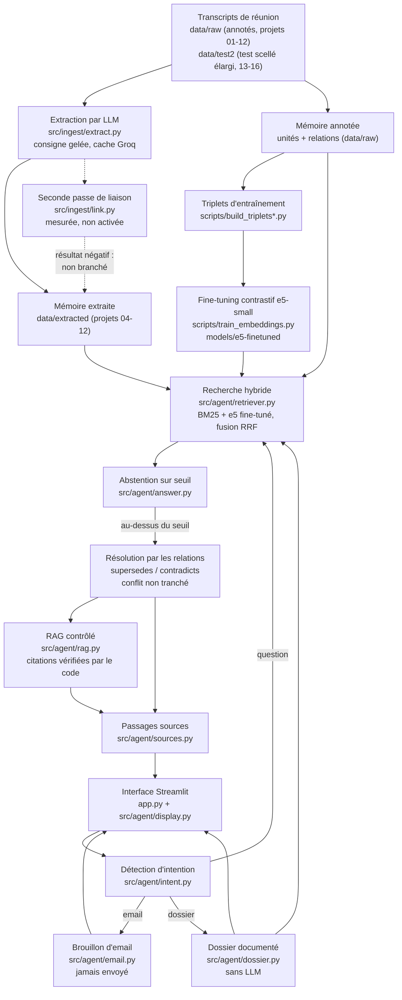

# Architecture

Ce document décrit la chaîne complète, des transcripts à l'interface, et le rôle de chaque module. Les chiffres cités renvoient aux fichiers de `eval/results` ; les choix et leurs alternatives sont dans [DECISIONS.md](DECISIONS.md).

## Chaîne complète

Le LLM (openai/gpt-oss-120b via Groq) n'intervient qu'à quatre endroits : la reformulation des ancres des triplets, l'extraction, la seconde passe de liaison (mesurée, non activée) et le RAG contrôlé. Il n'intervient jamais dans la recherche, la résolution, le seuil d'abstention, l'email ni le dossier. Chaque réponse Groq est mise en cache (`src/ingest/groq_client.py`) ; sans réseau ni clé, l'agent répond de façon extractive.

## Rôle de chaque module

| Module | Rôle |
|---|---|
| `src/schemas.py` | Contrats de données pydantic : unité sémantique (type, statut, preuve), relation typée, brouillon d'email. |
| `src/memory/corpus.py` | Chargement des unités, relations, participants et requêtes depuis un répertoire au format de `data/raw`. |
| `src/memory/extracted.py` | Mémoire extraite (`data/extracted`) : même retriever et même graphe que la mémoire annotée. |
| `src/retrieval/bm25_baseline.py` | Recherche BM25 par projet. |
| `src/retrieval/dense_baseline.py` | Recherche dense e5 par projet (préfixes `query:` / `passage:`). |
| `src/ingest/groq_client.py` | Client Groq : clé lue dans l'environnement ou `.env`, appels espacés, cache JSONL de chaque réponse. |
| `src/ingest/extract.py` | Extraction des unités et relations d'une réunion ; consigne gelée, validation stricte des preuves et des identifiants. |
| `src/ingest/link.py` | Seconde passe de liaison des relations (candidats par voisinage e5, un appel par projet, validation par le code). |
| `src/agent/retriever.py` | Recherche hybride de l'agent : BM25 et e5 fine-tuné fusionnés par RRF (k = 60). |
| `src/agent/answer.py` | Réponse sourcée : abstention sous le seuil de similarité, questions écartées, résolution des unités périmées, historique, conflit non tranché. |
| `src/agent/rag.py` | RAG contrôlé : synthèse à partir des unités retrouvées, chaque citation vérifiée ; sinon réponse extractive. |
| `src/agent/intent.py` | Détection d'intention par règles : dossier, email ou question. |
| `src/agent/email.py` | Brouillon d'email à la personne qui doit faire la tâche (premier participant nommé), sans adresse inventée ni envoi. |
| `src/agent/dossier.py` | Dossier documenté déterministe : décisions en vigueur, historique, conflits, actions et engagements, risques, questions ouvertes, sources. |
| `src/agent/sources.py` | Retrouve dans le transcript la prise de parole qui contient la preuve d'une unité. |
| `src/agent/display.py` | Libellés d'affichage : type en français, proposition non validée, échéance « le jour même » datée. |
| `app.py` | Interface Streamlit ; appelle directement `src/agent`. |
| `scripts/` | Validation du corpus, triplets, entraînement, mémoire extraite, vérification et lancement de la démonstration. |
| `eval/` | Évaluations ; chaque script écrit un JSON de `eval/results` avec ses métadonnées et empreintes. |

## Données et jeux d'évaluation

- `data/raw` : 12 projets annotés à la main. Projets 01-03 : réglage de la consigne d'extraction ; 01-10 : développement ; 11-12 : test scellé.
- `data/test2` : 4 projets (13-16) et `data/eval/queries_test2.json`, rédigés par l'assistant de développement et gelés avant toute exécution (`data/eval/test2_manifest.json`).
- `data/extracted` : mémoire produite par l'extraction (projets 04-12), sans correction manuelle.
- `data/processed` : triplets d'entraînement et cache versionné du RAG ; les autres caches Groq ne sont pas versionnés.
